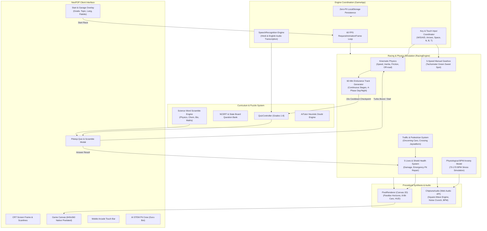
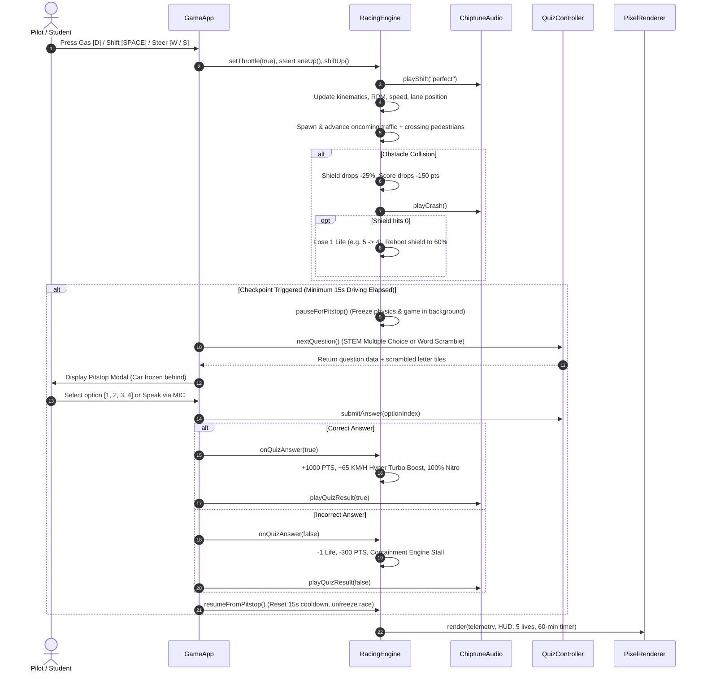

# Sankhya Turbo: 8-Bit Grand Prix (संख्या टर्बो)

An authentic 8-bit retro arcade motorsport and STEM learning game for Grades 1 through 8 in Hindi and English. Inspired by classic 8-bit racers and designed with CRED NeoPOP neo-brutalist aesthetics.

- **Live Deployment (Cloudflare Pages)**: [https://sankhya-strike.pages.dev](https://sankhya-strike.pages.dev)
- **GitHub Repository**: [https://github.com/z99wE/sankhya-strike](https://github.com/z99wE/sankhya-strike)
- **Design Philosophy**: Pure 8-bit retro graphics, CRED NeoPOP 3D plinths, high-contrast Devanagari typography, **strictly 0 icons and 0 emojis**.

---

## Architecture Overview



---

## Data Flow & Racing Loop



---

## Core System Architecture

### 1. Kinematic Physics & Transmission (`RacingEngine`)
- **Discrete & Continuous Lane Steering**: Dedicated support for discrete lane snapping (Lanes 0, 1, and 2) alongside continuous lateral guidance.
- **5-Speed Manual Gearbox**: Dynamically calculates instantaneous torque and wheel RPM. Shifting up inside the green zone (5800 - 7000 RPM) awards a *Perfect Shift* speed surge and nitro recharge.
- **Active Braking & Downshifting**: Engine braking via downshift (`X` / `Shift`) and active deceleration (`A` / `Left Arrow`) allows navigating dense incoming traffic jams.
- **Off-Road Friction**: Veering off the asphalt onto the dirt shoulders caps speed at 40 km/h, applies rolling resistance, rumbles the chassis, and kicks up grass particles.

### 2. Live Hazards: Traffic & Pedestrians
- **Oncoming Highway Traffic**: High-speed oncoming vehicles cruise in opposite lanes with headlights illuminating towards the player.
- **Crossing Jaywalkers**: Animated 8-bit pedestrians traverse between the upper and lower sidewalks, forcing quick braking or lane switches.
- **Impact Consequences**: Collisions reduce shield and deteriorate player score. Depleting a shield loses 1 life and triggers an emergency pitstop chassis repair.

### 3. 5 Lives System & 60-Minute Grand Prix
- **5 Lives per Race**: The player begins with 5 lives. Wrong answers in STEM challenges or severe collisions deduct lives.
- **60-Minute Continuous Endurance**: Tracks dynamic procedural circuits across an hour-long curriculum session.
- **Day-to-Night Progression**: The sky, curbs, lighting, and horizon transition seamlessly every 15 minutes:
  1. *Golden Dawn (सुनहरा प्रभात)*
  2. *High Noon Cyberway (दोपहर साइबरवे)*
  3. *Synthwave Sunset (संध्या गोधूलि)*
  4. *Midnight Neon Expressway (मध्यरात्रि एक्सप्रेसवे)*
- **Game Over vs. Championship Victory**: Surviving the 60 minutes crowns the player *60-Minute Grand Prix Science Champion*; losing all 5 lives triggers a *Game Over* screen with complete learning analytics.

### 4. STEM Education & Science Scramble (`QuizController`)
- **Class 1 to 8 NCERT Curriculum**: Deep coverage across Physics, Chemistry, Biology, and Mathematics.
- **Science Word Scramble Puzzles (Scrabble Style)**: Challenges the student to unscramble scientific terms from 8-bit letter tiles (`[R] [C] [O] [F] [E]` $\rightarrow$ `FORCE`, `[T] [M] [A] [O]` $\rightarrow$ `ATOM`, `[L] [E] [C] [L]` $\rightarrow$ `CELL`).
- **Formula & Law Match**: Chemical formula and physics law validation (`H2O`, `NaCl`, `CO2`, `F = m * a`, `V = I * R`).
- **Dynamic Custom Topic Synthesizer**: Students can type or speak any custom subject (e.g. *Photosynthesis*, *Newton's laws*, *Acids and bases*), and the engine dynamically constructs customized challenges.

### 5. Exam Anxiety & Physiological Vagus Model
- **Stress Pulse BPM (70 - 170 BPM)**: Simulates physiological response based on vehicle speed, rival proximity, low shield, and pitstop urgency.
- **Audio-Visual Feedback**: Procedural heartbeat audio (`lub-dub`) and a soft red vignette border activate above 125 BPM.
- **Pranayama Zen Breath (`B` Key)**: Triggers an instant vagus nerve reset, slowing simulation time by 50% (bullet-time calm focus for 3.5 seconds) and returning pulse to 72 BPM.

### 6. Pure 8-Bit Pixel Renderer (`PixelRenderer`)
- Native $640 \times 360$ rasterization with hardware crisp pixel scaling (`image-rendering: pixelated`).
- CRT scanline emulation and curved arcade bezel.
- Inconspicuous 9px floating player nametag above the chassis with translucent background, keeping racing immersion clean and non-distracting.
- **Zero Icons and Zero Emojis**: All indicators are rendered via pure Canvas shapes or retro monospace character brackets (`[1]`, `[2]`, `[GAS]`, `[BRAKE]`).

---

## Controls Reference

| Action | Desktop Keyboard | Mobile Touch Bar | Function |
| :--- | :--- | :--- | :--- |
| **Lane UP** | `W` / `Arrow Up` / `L` | `[W] LANE UP` | Switch lane upward / dodge oncoming hazards |
| **Lane DOWN** | `S` / `Arrow Down` / `R` | `[S] LANE DOWN` | Switch lane downward / dodge pedestrians |
| **Accelerate (Gas)** | `D` / `Arrow Right` | `[D] GAS` | Hold to accelerate forward |
| **Active Brake** | `A` / `Arrow Left` | `[A] BRAKE` | Rapid deceleration with red brake lights |
| **Shift Up** | `SPACEBAR` | `SHIFT [SPACE]` | Shift gear up (Aim for Green Sweet Spot) |
| **Shift Down** | `X` / `Left Shift` | `GEAR -` | Engine brake for tight maneuvers |
| **Super Nitro** | `N` | `NITRO [N]` | Activate $350+$ KM/H overdrive surge |
| **Zen Breath** | `B` | `ZEN [B]` | Bullet-time slow motion & pulse reset |
| **AI Pit Tutor** | `T` | `TUTOR [T]` | Toggle AI STEM Pit Crew doubt solver |
| **Answer STEM** | `1`, `2`, `3`, `4` | Click Option | Submit question or puzzle choice |
| **Voice Input** | Click `[MIC]` | Click `[MIC]` | Speak custom topics or say option number |

---

## Cool Alternative Project Names

If you want to rebrand from **Sankhya Strike**, here are curated, punchy name alternatives organized by theme:

### Category A: Retro Arcade Motorsport + Science (Fast & Catchy)
1. **Vigyan Velocity (विज्ञान वेलोसिटी)**: Blends traditional Indian science terminology with motorsport speed.
2. **Quantum Apex 500**: Combines high-octane racing apexes with physics concepts.
3. **Formula Vidya (फॉर्मूला विद्या)**: A play on Formula 1 motorsport and knowledge/learning.
4. **Nitro Vidyarthi (नाइत्रो विद्यार्थी)**: High-energy student racer identity.
5. **Turbo Tattva (टर्बो तत्व)**: *Tattva* signifies fundamental elements of nature/chemistry with turbo boost.

### Category B: Retro 8-Bit & Cyber Arcade
6. **Pixel Pulse GP**: Highlights the 8-bit retro visuals and the physiological anxiety pulse mechanic.
7. **Circuit Shastri (सर्किट शास्त्री)**: Playful double meaning of racing circuit / electrical circuit + scientific scholar.
8. **Apex Aryabhata**: Honors India's pioneer mathematician & astronomer with modern racing flair.
9. **Cyber Bodh (साइबर बोध)**: Cyberpunk retro styling paired with *Bodh* (deep understanding/enlightenment).
10. **Gati Grand Prix (गति ग्रैंड प्रिक्स)**: *Gati* means speed/momentum in Hindi and Sanskrit, perfectly capturing the physics racing core.

---

## Development & Verification

```bash
# 1. Install dependencies
npm install

# 2. Run lint & syntax validation
npm run lint

# 3. Execute test suite (33 unit tests)
npm test

# 4. Run automated E2E browser verification (Headless Chrome via CDP WebSocket)
npm run test:e2e

# 5. Production build
npm run build

# 6. Deploy to Cloudflare Pages
npm run deploy
```

---

## License & Ethics
Open-source educational initiative dedicated to providing accessible, high-performance STEM learning in regional Indian languages with strict zero-PII privacy protection.
